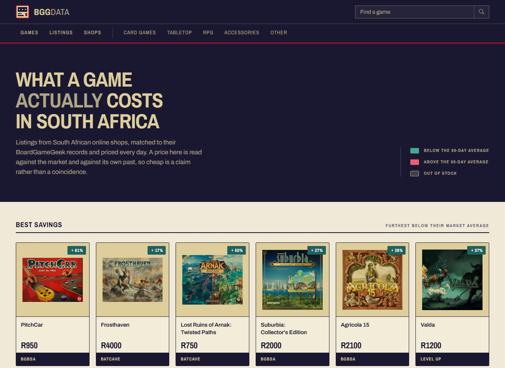
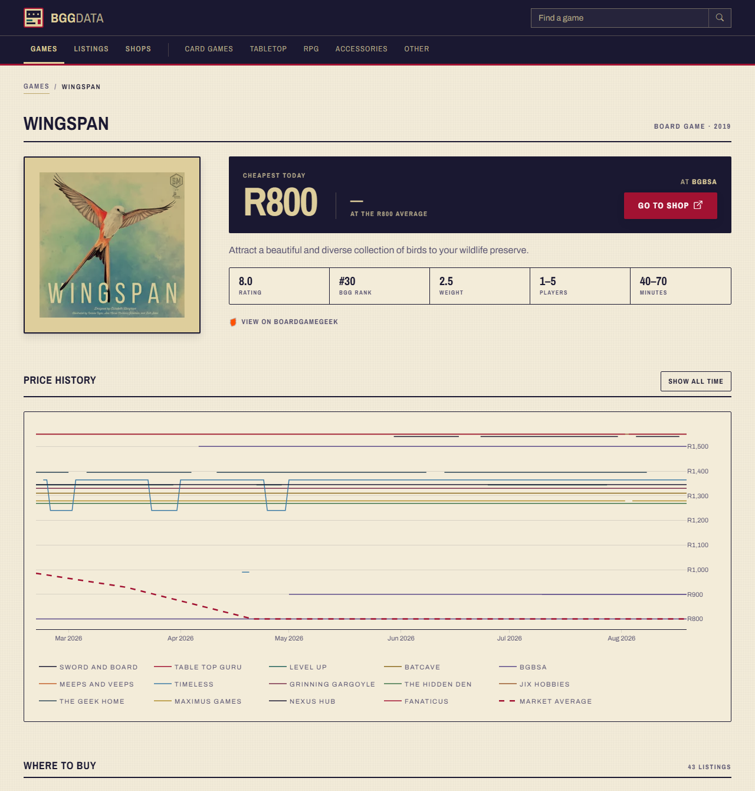

# BGG Data

**What a game actually costs in South Africa.**

Live at **[bggdata.co.za](https://bggdata.co.za)**

BGG Data tracks board game prices across South African online shops, matches each listing
to its [BoardGameGeek](https://boardgamegeek.com) record and records the price daily, so
"cheap" is a claim, not a coincidence: a price is shown against the market and its past.

## What it does

- **Finds the cheapest shop today.** Every game page leads with the lowest current price,
  which shop it is at, and how far that sits below (or above) the 90-day market average.
- **Keeps the price history.** Each listing is priced daily, so a game's page shows every
  shop's line over time plus a rolling market average.
- **Covers the market.** 17 shop scrapers (14 currently live), joined to BGG identity so
  the same game across shops is the same game. Browsable by category: board games, card
  games, tabletop, RPG, accessories, bundles and other.
- **Sleeves by card size** (`/sleeves`). Every sleeve whose size the shop printed in its
  name. Sold-out sleeves sit at the bottom under any sort, struck through, at their last
  in-stock price. A card's width × height ranks the sheet in the browser: sizes within
  0.5mm on both sides first (shops print 63 and 63.5 for one card), in stock then sold out;
  a gap; bigger sleeves in stock; then too small. Other sold-out sleeves hide until cleared.
- **Suggests what to play next** (`/plays`). It reads a BGG user's logged plays and, on
  every play day, counts the top 3 suggested games that weren't played as skipped. A game's
  first play day counts as one play and skips nothing (a new game gets played for being
  new). The score combines plays vs skips with how long since each game was last played or
  skipped (see `main/plays.py`). A game is marked **Sell** once 3 plays per played game
  have been logged since its last play (54 games played → 162 plays). Counted in plays, not
  days, the bar grows with the collection, comes sooner for frequent players, and never
  trips for a player who stopped logging.
- **No accounts, no ads, no affiliate links.** It is anonymous and free, and every
  outbound shop link is a plain link.

Price history for Wingspan across fourteen shops, with the market average dashed in red:

## How it works

Per-shop scrapers pull listings and prices, each scrape logged. Listings are matched to BGG
games (bringing ratings, rank, weight, player counts, play time). Every listing gets a price
per day, giving each game a price series and a 90-day rolling average. Views are cached for
ten minutes; graphs are rendered server-side.

**Failed scrapes.** `manage.py shop <name|all|home>` scrapes each shop and writes a
`Scrapelog` for it: `OK`, or the error that stopped it. A request still failing after its
retries raises, as does a shelf whose first page holds no products (blocked, or the layout
changed); an empty *later* page just ends the shelf. `/shops` and the shop page show the
last `OK` scrape date only. If any shop failed, the command (and `manage.py cron`, after
its BGG steps) exits non-zero once every shop has had its turn.

`main.games.get` retries 429/430/401/403/5xx responses and connection errors up to 7 times
(3s doubling to 60s). So an `ERROR Too many requests …` line followed by `retrying in 3
seconds` is a retry, not a failure. With `redirect=True` a redirect to another host raises
`OffsiteRedirectError` at once, unretried. Every error carries a message (e.g. `Blocked
(HTTP 403): <url>`), and that message is the `Scrapelog` outcome.

**Timeless** is read from its shop sheet alone (`/online-shop/?category=…&page=…`, 27 cards
a page, ~50 pages of board games). On a sale card a `<strike>` holds the old price ahead of
the current one. Sold-out products are left off the sheet (since 2026-11-17), so
`missed_listings` marks them out of stock. On 2026-11-17 the sheet briefly carried no
prices (each product page had one); they were back the same day.

**Blocked shops** (checked 2026-11-17). The droplet (DigitalOcean, NL, UTC) runs `manage.py
cron` at 12:00 UTC from its crontab, not this repo; shops take ~20 min, the BGG steps hours.
**The Geek Home** redirected the old 03:00 UTC run to `https://127.0.0.1/` (a WordPress
security plugin turning a visitor away) but answers at 12:28; `scrape_first = True` puts it
first in `shop all`. **The Hidden Den** and **Pwned Games** answer the droplet 403 and a
home Vodacom IP 200. Via PIA's `south-africa` region (AS212238 Datacamp, JNB) Hidden Den
gives 200, Pwned Cloudflare's hard "Sorry, you have been blocked" (WAF rule, no JS challenge).

**Scraped from home.** `shop all` skips shops with `via_home = True` (those two). The home
laptop's task "bggd home scrape" (13:00 SAST = 11:00 UTC, or on wake if missed; logged-on
only, as S4U needs admin) runs `%LOCALAPPDATA%\bggd\home-scrape.cmd` under `conhost
--headless`: `ssh -R 1080 bgg@<droplet> "… ALL_PROXY=socks5h://127.0.0.1:1080 … shop home"`,
last output in `home-scrape.log` beside it. `-R 1080` alone opens a SOCKS proxy on the
droplet's localhost exiting from the laptop; `requests` honours `ALL_PROXY`. PIA stays on: its
split tunnel lets `C:\Windows\System32\OpenSSH\ssh.exe` bypass it. Both shops took ~17 min
on 2026-11-17. Pwned's Cloudflare also 403s curl's default User-Agent.

## Tech stack

| | |
|---|---|
| Backend | Django 5.1 on Python 3.11+ |
| Data | SQLite (>1 GB of price history) |
| Frontend | Server-rendered Django templates, Bootstrap 5.3, htmx — no SPA |
| Tables & filters | django-tables2, django-filter |
| Graphs | Plotly, rendered server-side |
| Scraping | requests, BeautifulSoup, Botasaurus |
| Hosting | DigitalOcean, deployed by GitHub Actions on a `v*` tag |

## Notes

Not affiliated with BoardGameGeek: it consumes BGG data and links back. Prices are scraped,
so imperfect: a shop's own site, where every link here ends up, is the final word.
